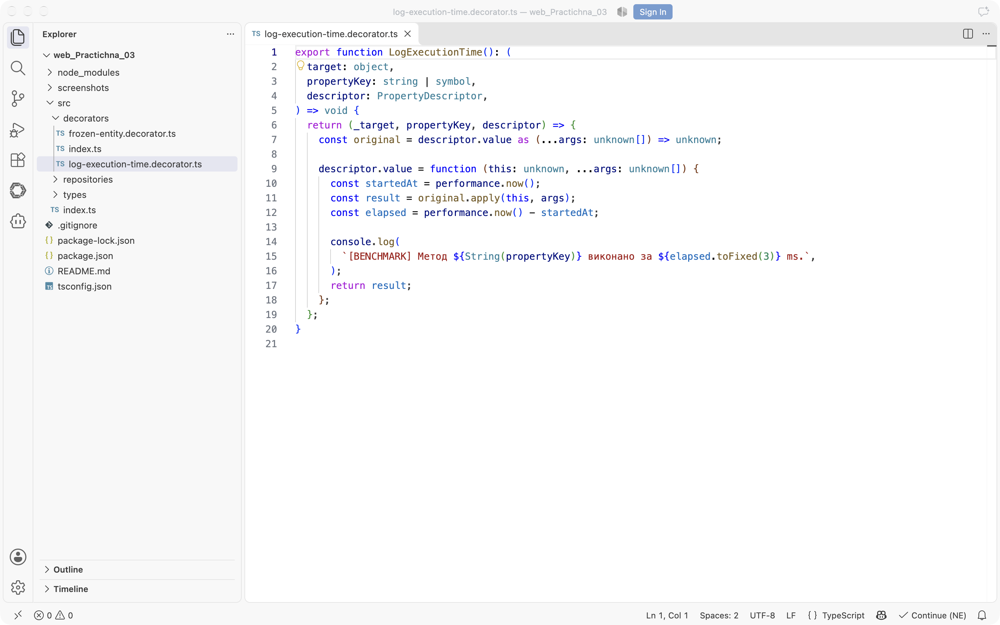
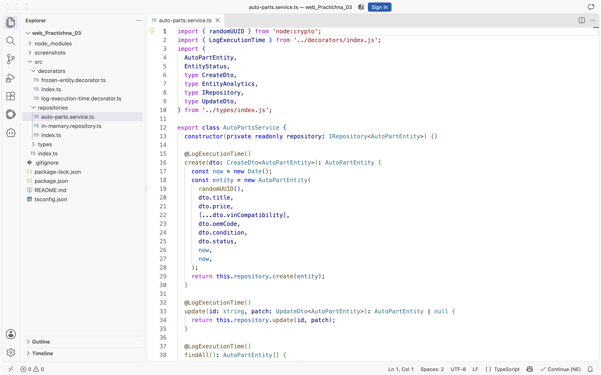
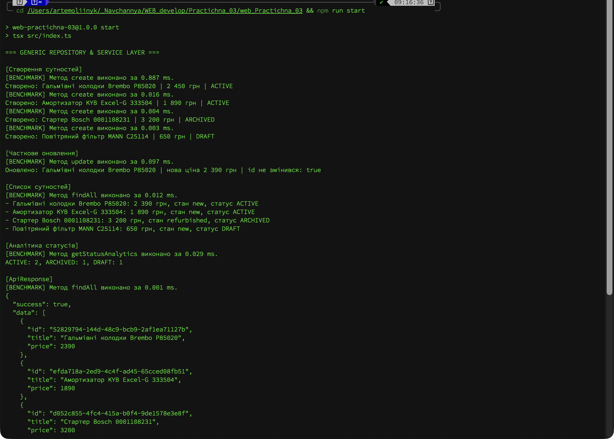
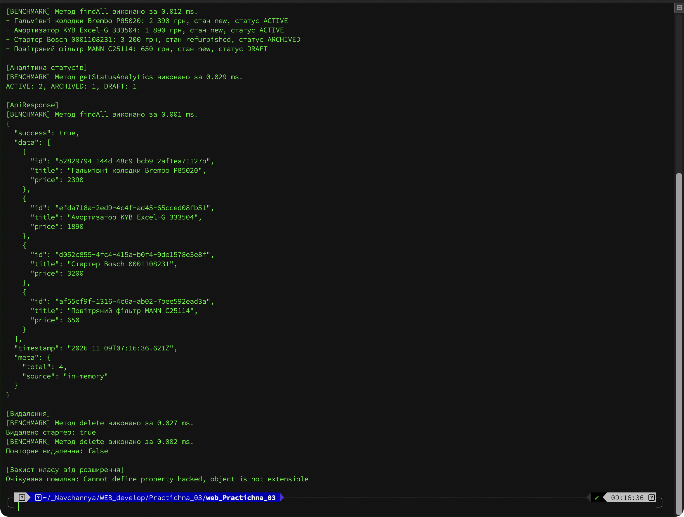
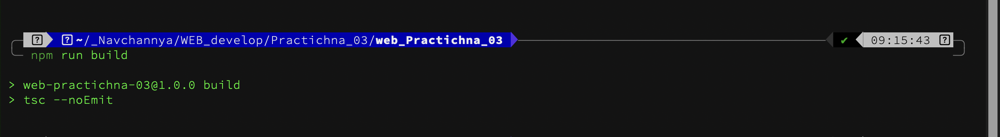

# Практична робота № 3

## Узагальнення, декоратори та утиліти типів TypeScript

**Виконав:** Олійник Артем Сергійович
**Курс:** IV
**Група:** КН-43
**Дисципліна:** WEB-розробка
**Варіант:** 7 (автозапчастини, `AutoPartEntity`)
**Рік:** 2026

---

## Мета роботи

- Побудувати універсальний generic-репозиторій для зберігання сутностей у пам'яті.
- Навчитися генерувати DTO та зведені типи через `Omit`, `Partial`, `Pick` і `Record`.
- Розібрати метапрограмування TypeScript: декоратори методу й класу, перехоплення викликів і захист від розширення.

## Середовище виконання

| Компонент | Версія |
|---|---|
| Node.js | 26.9.0 |
| npm | 11.19.1 |
| TypeScript | 5.9 |
| tsx | 4.20 |
| ОС | macOS 26 |

## Структура проєкту

```text
web_Practichna_03/
├── src/
│   ├── types/
│   │   ├── base-entity.ts
│   │   ├── api-response.ts
│   │   ├── entity-status.ts
│   │   ├── dto.ts
│   │   ├── repository.ts
│   │   ├── auto-part-entity.ts
│   │   └── index.ts
│   ├── repositories/
│   │   ├── in-memory.repository.ts
│   │   ├── auto-parts.service.ts
│   │   └── index.ts
│   ├── decorators/
│   │   ├── log-execution-time.decorator.ts
│   │   ├── frozen-entity.decorator.ts
│   │   └── index.ts
│   └── index.ts
├── screenshots/
├── package.json
├── tsconfig.json
└── README.md
```

---

## Хід виконання

### Рівень 1. Generic-інтерфейси та In-Memory Repository

У `tsconfig.json` увімкнено суворий режим і підтримку декораторів:

```json
{
  "compilerOptions": {
    "target": "ES2022",
    "module": "NodeNext",
    "moduleResolution": "NodeNext",
    "strict": true,
    "noImplicitAny": true,
    "experimentalDecorators": true,
    "emitDecoratorMetadata": true
  }
}
```

Базова сутність містить уніфіковані системні поля:

```ts
export interface BaseEntity {
  id: string;
  createdAt: Date;
  updatedAt: Date;
}
```

Стандартизована відповідь API параметризується типом даних:

```ts
export interface ApiResponse<TData> {
  success: boolean;
  data: TData;
  timestamp: Date;
  meta?: Record<string, unknown>;
}
```

Контракт репозиторію описує повний набір операцій, включно з частковим оновленням:

```ts
export interface IRepository<T extends BaseEntity> {
  create(item: T): T;
  findById(id: string): T | null;
  findAll(): T[];
  update(id: string, patch: UpdateDto<T>): T | null;
  deleteById(id: string): boolean;
}
```

`InMemoryRepository<T>` зберігає елементи в масиві. Метод `update` зберігає первинний ключ і дату створення, а `updatedAt` завжди замінює на поточний час:

```ts
update(id: string, patch: UpdateDto<T>): T | null {
  const index = this.items.findIndex((item) => item.id === id);
  if (index === -1) {
    return null;
  }

  const current = this.items[index];
  if (!current) {
    return null;
  }

  const updated = {
    ...current,
    ...patch,
    id: current.id,
    createdAt: current.createdAt,
    updatedAt: new Date(),
  } as T;

  this.items[index] = updated;
  return updated;
}
```

Сутність варіанта 7 розширює базові поля характеристиками автозапчастини:

```ts
@FrozenEntity()
export class AutoPartEntity implements BaseEntity {
  constructor(
    public readonly id: string,
    public title: string,
    public price: number,
    public vinCompatibility: string[],
    public oemCode: string,
    public condition: 'new' | 'refurbished',
    public status: EntityStatus,
    public readonly createdAt: Date,
    public updatedAt: Date,
  ) {}
}
```

### Рівень 2. Utility Types та DTO

Статуси описані рядковим перерахуванням:

```ts
export enum EntityStatus {
  Active = 'ACTIVE',
  Archived = 'ARCHIVED',
  Draft = 'DRAFT',
}
```

Типи DTO генеруються з моделі без дублювання полів:

```ts
export type CreateDto<T extends BaseEntity> = Omit<
  T,
  'id' | 'createdAt' | 'updatedAt'
>;

export type UpdateDto<T extends BaseEntity> = Partial<CreateDto<T>>;

export type EntitySummary<
  T extends BaseEntity & { title: string; price: number },
> = Pick<T, 'id' | 'title' | 'price'>;

export type EntityAnalytics<T extends BaseEntity> = Record<EntityStatus, number>;
```

`CreateDto` прибирає системні поля, `UpdateDto` робить решту необов'язковими, `EntitySummary` залишає лише `id`, `title` і `price`, а `EntityAnalytics` описує словник лічильників для кожного статусу.

Предметний сервіс приймає DTO, самостійно створює сутність із згенерованим `id` та передає її в репозиторій:

```ts
@LogExecutionTime()
create(dto: CreateDto<AutoPartEntity>): AutoPartEntity {
  const now = new Date();
  const entity = new AutoPartEntity(
    randomUUID(),
    dto.title,
    dto.price,
    [...dto.vinCompatibility],
    dto.oemCode,
    dto.condition,
    dto.status,
    now,
    now,
  );
  return this.repository.create(entity);
}
```

### Рівень 3. Декоратори та barrel-файли

Декоратор методу зберігає оригінальну функцію, заміряє час через `performance.now()` і повертає результат без змін:

```ts
export function LogExecutionTime(): (
  target: object,
  propertyKey: string | symbol,
  descriptor: PropertyDescriptor,
) => void {
  return (_target, propertyKey, descriptor) => {
    const original = descriptor.value as (...args: unknown[]) => unknown;

    descriptor.value = function (this: unknown, ...args: unknown[]) {
      const startedAt = performance.now();
      const result = original.apply(this, args);
      const elapsed = performance.now() - startedAt;

      console.log(
        `[BENCHMARK] Метод ${String(propertyKey)} виконано за ${elapsed.toFixed(3)} ms.`,
      );
      return result;
    };
  };
}
```



Декоратор класу заморожує конструктор і прототип, тому додати метод у процесі виконання вже неможливо:

```ts
export function FrozenEntity(): ClassDecorator {
  return (constructor) => {
    Object.freeze(constructor);
    Object.freeze(constructor.prototype);
  };
}
```

Кожен підкаталог має `index.ts` для централізованого реекспорту. Це дає змогу імпортувати типи, репозиторії та декоратори з одного шляху й не тягнути довгі ланцюжки файлів.



### Демонстрація роботи

`src/index.ts` створює чотири сутності через `CreateDto`, оновлює ціну однієї з них, будує аналітику статусів і обгортає зведення в `ApiResponse`. Реальний вивід:

```text
=== GENERIC REPOSITORY & SERVICE LAYER ===

[Створення сутностей]
[BENCHMARK] Метод create виконано за 0.990 ms.
Створено: Гальмівні колодки Brembo P85020 | 2 450 грн | ACTIVE
[BENCHMARK] Метод create виконано за 0.009 ms.
Створено: Амортизатор KYB Excel-G 333504 | 1 890 грн | ACTIVE
[BENCHMARK] Метод create виконано за 0.003 ms.
Створено: Стартер Bosch 0001108231 | 3 200 грн | ARCHIVED
[BENCHMARK] Метод create виконано за 0.002 ms.
Створено: Повітряний фільтр MANN C25114 | 650 грн | DRAFT

[Часткове оновлення]
[BENCHMARK] Метод update виконано за 0.044 ms.
Оновлено: Гальмівні колодки Brembo P85020 | нова ціна 2 390 грн | id не змінився: true

[Список сутностей]
[BENCHMARK] Метод findAll виконано за 0.012 ms.
- Гальмівні колодки Brembo P85020: 2 390 грн, стан new, статус ACTIVE
- Амортизатор KYB Excel-G 333504: 1 890 грн, стан new, статус ACTIVE
- Стартер Bosch 0001108231: 3 200 грн, стан refurbished, статус ARCHIVED
- Повітряний фільтр MANN C25114: 650 грн, стан new, статус DRAFT

[Аналітика статусів]
[BENCHMARK] Метод getStatusAnalytics виконано за 0.025 ms.
ACTIVE: 2, ARCHIVED: 1, DRAFT: 1

[ApiResponse]
{
  "success": true,
  "data": [
    {
      "id": "aa7abbf3-39dc-4f30-a5e9-0ed5c27edb8a",
      "title": "Гальмівні колодки Brembo P85020",
      "price": 2390
    },
    {
      "id": "d54fb501-76a6-4242-9d7d-09ade5bfcf98",
      "title": "Амортизатор KYB Excel-G 333504",
      "price": 1890
    },
    {
      "id": "64ad606e-d3d2-4c19-ad57-c837136eeb8f",
      "title": "Стартер Bosch 0001108231",
      "price": 3200
    },
    {
      "id": "756800a2-f415-45c9-9d8f-de57c5fdc3b1",
      "title": "Повітряний фільтр MANN C25114",
      "price": 650
    }
  ],
  "timestamp": "2026-11-08T23:41:26.054Z",
  "meta": {
    "total": 4,
    "source": "in-memory"
  }
}

[Видалення]
[BENCHMARK] Метод delete виконано за 0.020 ms.
Видалено стартер: true
[BENCHMARK] Метод delete виконано за 0.002 ms.
Повторне видалення: false

[Захист класу від розширення]
Очікувана помилка: Cannot define property hacked, object is not extensible
```





## Перевірка відсутності помилок

Команда `npm run build` запускає `tsc --noEmit` у суворому режимі. Компіляція завершується без повідомлень, отже generic-типи, DTO та декоратори узгоджені.



| Перевірка | Результат |
|---|---|
| `tsc --noEmit` | 0 помилок |
| Створення через `CreateDto` | 4 сутності |
| Часткове оновлення | ціна змінена, `id` і `createdAt` збережені |
| Аналітика | `ACTIVE: 2, ARCHIVED: 1, DRAFT: 1` |
| `EntitySummary` | лише `id`, `title`, `price` |
| `ApiResponse` | `success: true`, `meta.total: 4` |
| Видалення | перше `true`, повторне `false` |
| `@FrozenEntity` | прототип заморожений, розширення заблоковане |
| `@LogExecutionTime` | час кожного виклику виведено |

## Висновки

Generic-репозиторій дає змогу працювати з будь-якою сутністю, що реалізує `BaseEntity`, без дублювання коду для кожного типу. Компілятор перевіряє, що `create`, `findById` і `update` повертають саме той тип, який передали в параметрі.

Utility Types прибирають ручне дублювання DTO. Якщо в модель додати нове поле, `CreateDto` і `UpdateDto` оновляться автоматично, а місця, де поле обов'язкове, буде видно на етапі компіляції.

Декоратори показали, як TypeScript працює з метаданими під час виконання: `@LogExecutionTime` перехоплює метод через `PropertyDescriptor`, а `@FrozenEntity` захищає клас від динамічного розширення. Перевірка `Object.defineProperty` підтвердила, що після заморожування прототип не приймає нових властивостей.

## Інструкція запуску

```bash
npm install
npm run build
npm run start
```
